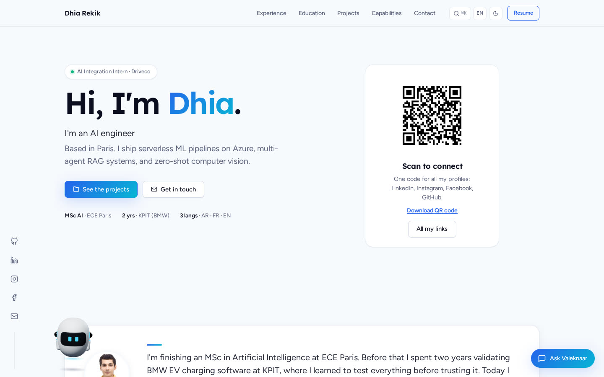

# dhiarekik.me

My personal website: experience, projects, freelance work and contact, in English and French.

**Live: https://dhiarekik.me**



## What it does

- **Projects** are loaded from my GitHub repositories, with a short case study for each one. Projects that can be tried online get a "Try it live" button (for example [AI Vision Detection](https://dhiarekik.me/ai-vision-detection/)).
- **Valeknaar**, a small 3D robot built with three.js, floats along the bottom of the page, suggests things to look at, and can be dragged and thrown. Tapping it opens a chat assistant that answers questions about me.
- **A links page** at [/links](https://dhiarekik.me/links/) with all my profiles, and a QR code to it on the home page.
- **English and French**, light and dark themes, and a contact form.

## Results

| | Result |
|---|---|
| Lighthouse, desktop | Performance 98, Accessibility 100, Best practices 100, SEO 100 |
| Lighthouse, mobile | Performance 85, Accessibility 100, Best practices 100, SEO 100 |
| Page weight | about 180 KB |

Measured with Lighthouse 12 on the live site in October 2026.

## How it works

- Plain HTML, CSS and JavaScript with no build step, served by GitHub Pages.
- Translations live in `js/translations.js`; `js/i18n.js` swaps the text and remembers the choice.
- The robot (`js/robot/`) only loads on devices with GPU acceleration, and three.js is downloaded only in that case, so the rest of the page stays fast.
- The chat assistant calls a Cloudflare Worker (`worker/valeknaar.js`) that forwards questions to an LLM with a short profile as context.
- The contact form posts to Web3Forms.

## Run it

```bash
python3 -m http.server 8000   # then open http://localhost:8000
```

Add `?robot` to the URL to force the robot on machines without a GPU. The chat assistant is deployed separately from `worker/` with `npx wrangler deploy`.

## Project layout

| Path | What |
|---|---|
| `index.html` | The home page |
| `links/` | The links page behind the QR code |
| `css/styles.css` | All styles, light and dark |
| `js/` | Translations, page behaviour, projects, chat |
| `js/robot/` | The 3D robot: model and behaviour |
| `assets/` | Photo, company logos, QR code |
| `cv/` | CV in English and French |
| `worker/` | Cloudflare Worker for the chat assistant |
| `repos.json` | Fallback project list when the GitHub API is unavailable |

## Licence

The code is free to read and learn from. The text, photo and CV are mine; please don't reuse them.
